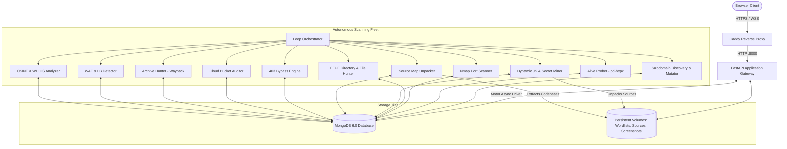

# RDash — External Attack Surface Management & Threat Hunting Platform

<p align="center">
  
  
  
  
  
  
  
</p>

---

## Table of Contents
1. [Overview](#overview)
2. [Core Architecture & Data Flow](#core-architecture--data-flow)
3. [Key Platform Features](#key-platform-features)
   - [Unified Search & Asset Inventory](#1-unified-search--asset-inventory)
   - [Hunting Leads & Alerting Engine](#2-hunting-leads--alerting-engine)
   - [Findings & PoC Documentation Studio](#3-findings--poc-documentation-studio)
   - [Tools Monitoring & Scanner Control](#4-tools-monitoring--scanner-control)
   - [Granular Settings & Trigger Controls](#5-granular-settings--trigger-controls)
   - [Dual Theme System (Cyber Dark & Daylight Light)](#6-dual-theme-system-cyber-dark--daylight-light)
   - [Enterprise Access Control & MFA](#7-enterprise-access-control--mfa)
4. [Reconnaissance Engines & Tools Catalog](#reconnaissance-engines--tools-catalog)
   - [Complete Tools Matrix](#complete-tools-matrix)
   - [1. subdomain_discovery.py — Active & Passive Subdomain Enumeration](#1-subdomain_discoverypy--active--passive-subdomain-enumeration)
   - [2. alive_check.py — HTTP/HTTPS Probing & Web Asset Verification](#2-alive_checkpy--httphttps-probing--web-asset-verification)
   - [4. port_scanner.py — Port & Service Profiler with Delta Tracking](#4-port_scannerpy--port--service-profiler-with-delta-tracking)
   - [5. directory_hunter.py — Two-Phase Recursive Directory & Sensitive File Hunter](#5-directory_hunterpy--two-phase-recursive-directory--sensitive-file-hunter)
   - [6. dynamic_js_collector.py — Headless JavaScript Crawler & Endpoint Miner](#6-dynamic_js_collectorpy--headless-javascript-crawler--endpoint-miner)
   - [7. source_map_unpacker.py — Webpack Source Map Extractor & Code Reconstructor](#7-source_map_unpackerpy--webpack-source-map-extractor--code-reconstructor)
   - [8. source_code_analyzer.py — Static Code Security & Entropy Secret Scanner](#8-source_code_analyzerpy--static-code-security--entropy-secret-scanner)
   - [9. bypass_403.py — Reverse Proxy Header & Traversal 403 Bypasser](#9-bypass_403py--reverse-proxy-header--traversal-403-bypasser)
   - [10. cloud_storage_auditor.py — S3, GCS & Azure Blob Bucket Auditor](#10-cloud_storage_auditorpy--s3-gcs--azure-blob-bucket-auditor)
   - [11. archive_hunter.py — Historical Wayback & Common Crawl URL Miner](#11-archive_hunterpy--historical-wayback--common-crawl-url-miner)
   - [12. tech_fingerprinter.py — Technology Stack & Header Regression Analyzer](#12-tech_fingerprinterpy--technology-stack--header-regression-analyzer)
   - [13. waf_detector.py — Web Application Firewall (WAF) Fingerprinter](#13-waf_detectorpy--web-application-firewall-waf-fingerprinter)
   - [14. lb_detector.py — Dual-Method Load Balancer & Reverse Proxy Detector](#14-lb_detectorpy--dual-method-load-balancer--reverse-proxy-detector)
   - [15. osint_agent.py — DNS Intelligence & SPF/DMARC Security Auditor](#15-osint_agentpy--dns-intelligence--spfdmarc-security-auditor)
   - [16. whois_agent.py — WHOIS Registrar & Domain Lifecycle Monitor](#16-whois_agentpy--whois-registrar--domain-lifecycle-monitor)
   - [17. screenshot_agent.py — Headless Chromium Visual Capture Agent](#17-screenshot_agentpy--headless-chromium-visual-capture-agent)
   - [18. loop_orchestrator.py — Continuous Workflow Pipeline Coordinator](#18-loop_orchestratorpy--continuous-workflow-pipeline-coordinator)
   - [19. base_agent.py — Core Agent Framework & Alert Deduplication Engine](#19-base_agentpy--core-agent-framework--alert-deduplication-engine)
5. [Installation & Deployment](#installation--deployment)
   - [Prerequisites & System Requirements](#prerequisites--system-requirements)
   - [Docker Deployment (Recommended)](#docker-deployment-recommended)
   - [Initial Admin Login & 2FA Setup](#initial-admin-login--2fa-setup)
6. [Manual / Local Development Setup](#manual--local-development-setup)
7. [Operational Workflows](#operational-workflows)
8. [Configuration Reference (`.env`)](#configuration-reference-env)
9. [Extending RDash: Writing Custom Agents](#extending-rdash-writing-custom-agents)
10. [Legal & Ethical Usage](#legal--ethical-usage)

---

## Overview

**RDash** is an enterprise-grade, self-hosted **External Attack Surface Management (EASM)** and automated threat hunting platform. Built for red teams, penetration testers, security operation centers (SOC), and bug bounty researchers, RDash moves beyond static snapshot scans by continuously maintaining a **living, correlated inventory** of an organization's perimeter.

Rather than relying on isolated command-line tools, RDash orchestrates a modular fleet of specialized reconnaissance micro-agents into a unified, high-performance web dashboard. Discovered assets, exposed secrets, vulnerable endpoints, and cloud storage misconfigurations are automatically analyzed, fingerprinted, deduplicated, and presented in real time.

```
       ┌─────────────────────────────────────────────────────────────┐
       │                       TARGET DOMAINS                        │
       └──────────────────────────────┬──────────────────────────────┘
                                      │
              ┌───────────────────────┴───────────────────────┐
              ▼                                               ▼
   [Passive Recon & OSINT]                        [Active Scanning Engines]
   • Subfinder & crt.sh                           • Nmap Port & Service Scanner
   • Wayback & Common Crawl                       • FFUF Phase 1 (Dirs) & Phase 2 (Files)
   • DNS / SPF / DMARC OSINT                      • 403 Forbidden Header Bypasser
   • Subdomain Permutations                       • Headless JS Crawler & Endpoint Miner
                                                  • Webpack Source Map Unpacker
                                                  • S3 / GCS / Azure Bucket Auditor
              │                                               │
              └───────────────────────┬───────────────────────┘
                                      │
                                      ▼
             ┌─────────────────────────────────────────────────┐
             │       RDash Core Orchestration Engine           │
             │  • Scope Enforcement & Deduplication            │
             │  • Risk-Tiered Alert Classification             │
             │  • Automated Secret Entropy Analysis            │
             │  • Real-Time MongoDB State Store                │
             └────────────────────────┬────────────────────────┘
                                      │
                                      ▼
             ┌─────────────────────────────────────────────────┐
             │      Unified Web Interface & Analyst Studio     │
             │  • Live Search & 9-Tab Diagnostic Inspector     │
             │  • Hunting Leads Triage & Excel Exporter        │
             │  • Markdown Exploit Studio with PoC Highlighting│
             │  • Granular Trigger Settings & Dual Themes      │
             └─────────────────────────────────────────────────┘
```

---

## Core Architecture & Data Flow

RDash is engineered using an asynchronous, microservices-style architecture designed for high throughput, resilience, and horizontal scalability:



- **API Gateway & Web Server**: Built with **FastAPI** (Python 3.11), leveraging asynchronous ASGI concurrency (`uvicorn`), client rate limiting (`slowapi`), and strict HTTP security headers.
- **Data Persistence**: **MongoDB** stores domain graphs, port maps, raw technical outputs, hunting leads, findings documentation, and configuration states.
- **Frontend Layer**: Modern HTML5, Vanilla JavaScript, and Tailwind CSS, featuring server-rendered Jinja2 templates, live Markdown rendering via `marked.js`, and multi-language syntax highlighting with `Prism.js`.
- **Edge Security & Routing**: **Caddy** acts as a reverse proxy providing automated SSL/TLS termination, HTTP/2 multiplexing, and static caching.
- **Agent Framework**: Standalone Python daemon processes subclasses from `BaseAgent` (`tools/base_agent.py`), communicating asynchronously via MongoDB collections for lock-free state synchronization and distributed execution.

---

## Key Platform Features

### 1. Unified Search & Asset Inventory
- **Real-Time Global Search**: Instant domain and IP address lookup across hundreds of thousands of target records with debounced queries.
- **Multi-Dimensional Filter Bar**: Filter inventory by Scan Status (`Scanned`, `Pending`, `On Hold`), Subdomain Existence (`Has Subdomains`, `No Subdomains`), Technology Stack, WAF Presence (`Cloudflare`, `AWS WAF`, `Imperva`, etc.), and Load Balancer Status.
- **9-Tab Diagnostic Asset Inspector**: Clicking any domain reveals a full-screen modal featuring:
  - **Overview**: IP address, country flag, reverse DNS, open ports, live screenshot thumbnail, and last-scanned timestamp.
  - **Analysis Summary**: Automated technology summary, discovered attack surface metrics, and risk overview.
  - **Exploitation Suggestions**: Actionable recommendations based on discovered ports, outdated technologies, and sensitive endpoints.
  - **Infrastructure**: Complete DNS records (A, AAAA, CNAME, MX, TXT, NS, SOA), CDN/WAF detection, and load balancer profiling.
  - **Systems & Network**: Service versions, banner grabs, and raw Nmap port inspection.
  - **Web Applications**: Discovered endpoints, HTTP status codes, response content lengths, page titles, and live links.
  - **OSINT**: Email security posture (SPF, DMARC, DKIM), registrar data, and nameservers.
  - **WHOIS**: Domain registration, expiry dates, registrar contact, and status codes.
  - **Raw Data**: JSON viewer for direct pipeline inspection.
- **Interactive Asset Menu**: Right-click or button-click on any domain to inspect asset details, copy domain to clipboard, or open directly in a new browser tab.

### 2. Hunting Leads & Alerting Engine
- **Automated Risk Categorization**: Alerts are classified into four severity tiers: **Critical** (exposed credentials, `.env` files, `.git` leaks, unauthenticated writable S3 buckets), **High** (403 bypasses, admin portals, source map secrets, open database ports), **Medium** (port changes, backup archives, missing security headers), and **Low / Info** (technology disclosures, DNS changes).
- **Fingerprint-Based Deduplication**: Cryptographic hash fingerprints (`md5`/`sha256`) prevent duplicate alerts when multiple scanners discover the same finding across recurring cycles.
- **Alert Triage Workflow**: Manage lifecycle states directly from the UI: `New` ➔ `In Progress` ➔ `Investigating` ➔ `True Positive` ➔ `False Positive` ➔ `Benign` ➔ `Muted`.
- **Alert Suppression / Muting**: Suppress noisy leads to prevent inbox flooding while retaining historical records.
- **Collaborative Notes Editor**: Inline notes editor with Markdown support and instant autosave for every lead.
- **One-Click Promotion to Findings**: Seamlessly convert any hunting lead into a confirmed vulnerability entry in the Findings studio.
- **Excel Export**: Download all filtered hunting leads into formatted `.xlsx` spreadsheets for stakeholder reports.

### 3. Findings & PoC Documentation Studio
- **Dedicated Vulnerability Tracking**: A purpose-built interface for documenting validated security bugs, internal penetration test findings, and bug bounty submissions.
- **Split-Screen Markdown Workspace**: Side-by-side authoring pane with live HTML preview.
- **PoC Syntax Highlighting**: Native syntax highlighting for exploit proof-of-concepts, including `HTTP` request/response pairs, `Bash` one-liners, `Python` exploit scripts, `JSON` API payloads, and `SQL` injection strings.
- **Quick-Insert Vulnerability Templates**: Pre-structured markdown templates for OWASP Top 10 vulnerabilities (IDOR, SQL Injection, SSRF, XSS, RCE, Authentication Bypass, Sensitive Data Exposure).
- **Metadata Tagging**: Categorize findings by Severity, Status (`Draft`, `Confirmed`, `In Progress`, `Remediated`), Target Asset URL, Vulnerability Category (CWE/OWASP), and CVE/CVSS Identifier.
- **Keyboard Shortcuts**: Full support for `Ctrl+S` / `Cmd+S` instant saving, `Ctrl+B` (Bold), `Ctrl+I` (Italic).

### 4. Tools Monitoring & Scanner Control
- **Real-Time Engine Status**: Live health and execution metrics for all 18+ reconnaissance background processes.
- **Dual View Modes**: Switch between responsive card tiles and detailed list tables showing engine key, scan cadence, and execution status.
- **Global Scan Control**: Single-click master dynamic toggle (`Start Scanning` / `Stop Scanning`) to immediately pause or resume all background scanner microservices.
- **On-Demand Targeted Execution**: Trigger any specific tool on demand against a single target domain or across all registered domains with custom parameter overrides.

### 5. Granular Settings & Trigger Controls
- **17 Configurable Alert Detection Triggers**: Granular toggles to enable or disable specific alert generation without disabling the underlying scanner engine:
  - *Directory & File Hunter*: Critical sensitive files (`.env`, `.git`), high-risk configs, backup archives, directory listings.
  - *Source Map & Code Secrets*: Source map exposure, high-entropy secrets and API tokens, internal endpoints.
  - *Cloud Storage*: Writable S3/GCS buckets, listable buckets.
  - *Access Control*: Successful 403 bypass exploits.
  - *OSINT & Infrastructure*: Missing SPF/DMARC, new subdomains, port changes, security header regressions.
  - *Historical Archives*: Wayback Machine leaked sensitive endpoints.
- **Batch Actions**: `Enable All`, `Disable All`, and `Reset to Defaults` buttons.
- **Queue & Data Maintenance**: Purge orphaned leads, clear scan caches, and reindex database collections.

### 6. Dual Theme System (Cyber Dark & Daylight Light)
- **WCAG AA Compliant Contrast**: Meticulously tuned text-to-background contrast ratios exceeding 7:1 for headers, body text, badges, and buttons in both modes.
- **Cyber Dark (Default)**: Sleek obsidian slate (`#0f172a` / `#1e293b`) with neon cyan accents, engineered for prolonged night-time analysis and terminal sessions.
- **Daylight Light**: Cool slate-50 (`#f8fafc`) canvas with crisp white cards, rich slate-900 typography, and saturated pastel status pills.
- **Terminal Preservation**: PoC code blocks and command outputs retain their high-contrast dark terminal theme (`#0b1120`) in both daylight and dark modes for optimal readability.
- **Zero-Flash Startup**: Early inline script reads `localStorage` before DOM paint, eliminating theme flashes on page load.
- **Persistent Backend Sync**: Theme preference automatically synchronizes with user account settings in MongoDB.

### 7. Enterprise Access Control & MFA
- **Role-Based Access Control (RBAC)**:
  - `Admin`: Full system control, target management, user provisioning, global settings, and audit logs.
  - `Analyst`: Asset inspection, tool triggering, alert triaging, and finding authoring.
  - `Viewer`: Read-only access to dashboards, alerts, and reports.
- **TOTP Two-Factor Authentication**: RFC 6238 compliant multi-factor authentication compatible with Google Authenticator, Authy, and 1Password. Includes a zero-dependency CLI token generator (`get_totp.py`).
- **Comprehensive Audit Trail**: Immutable logging of all user logins, target additions, setting changes, and finding modifications (`/logs`).

---

## Reconnaissance Engines & Tools Catalog

RDash bundles a suite of 19 autonomous, multi-threaded reconnaissance engines and core microservices located in the `tools/` directory. Each tool is engineered to execute either as part of the automated continuous background pipeline (managed by `loop_orchestrator.py`) or as a standalone, on-demand task triggered from the web interface.

### Complete Tools Matrix

| # | Tool Engine | Binary / Library | Primary Function | Database Target | Alerts Generated |
| :-: | :--- | :--- | :--- | :--- | :--- |
| **1** | [`subdomain_discovery.py`](#1-subdomain_discoverypy--active--passive-subdomain-enumeration) | `subfinder`, `dnspython` | Active & passive subdomain enumeration across 40+ OSINT sources | `domains`, `tasks` | `new_subdomain_discovered` (Low) |
| **2** | [`alive_check.py`](#2-alive_checkpy--httphttps-probing--web-asset-verification) | `pd-httpx`, `httpx` | High-concurrency HTTP/HTTPS probing, status codes, and web verification | `domains` | Web surface verification |
| **4** | [`port_scanner.py`](#4-port_scannerpy--port--service-profiler-with-delta-tracking) | `nmap`, NSE scripts | Port & service discovery, banner grabbing, and delta change detection | `domains.ports` | `port_scan_change` (High) |
| **5** | [`directory_hunter.py`](#5-directory_hunterpy--two-phase-recursive-directory--sensitive-file-hunter) | `ffuf`, `httpx` | Two-phase recursive directory enumeration & high-value sensitive file hunting | `domains.endpoints` | `sensitive_files_critical` (Critical), `sensitive_files_high` (High) |
| **6** | [`dynamic_js_collector.py`](#6-dynamic_js_collectorpy--headless-javascript-crawler--endpoint-miner) | Playwright Chromium | Headless browser SPA crawler, script extractor & API route miner | `domains.endpoints` | Route discovery, source map handoff |
| **7** | [`source_map_unpacker.py`](#7-source_map_unpackerpy--webpack-source-map-extractor--code-reconstructor) | Webpack v3 Engine | Reverse-engineers `.js.map` files and reconstructs full source codebases | `recovered_source_maps` | `source_map_exposed` (High) |
| **8** | [`source_code_analyzer.py`](#8-source_code_analyzerpy--static-code-security--entropy-secret-scanner) | Regex, Shannon Entropy | Static code analysis on recovered sources for API keys, tokens & credentials | `recovered_source_maps` | `source_map_secrets_leak` (Critical/High) |
| **9** | [`bypass_403.py`](#9-bypass_403py--reverse-proxy-header--traversal-403-bypasser) | `httpx`, Custom Heuristics | Reverse proxy header manipulation & path traversal against 403 Forbidden endpoints | `leads` | `bypass_403_success` (High) |
| **10** | [`cloud_storage_auditor.py`](#10-cloud_storage_auditorpy--s3-gcs--azure-blob-bucket-auditor) | `httpx`, XML Parsers | Cloud bucket permutations & permission testing (AWS S3, Google GCS, Azure) | `leads` | `cloud_storage_writable` (Critical), `cloud_storage_listable` (High) |
| **11** | [`archive_hunter.py`](#11-archive_hunterpy--historical-wayback--common-crawl-url-miner) | Wayback CDX, Common Crawl | Passive historical URL mining for deprecated endpoints, legacy backups & tokens | `domains.endpoints` | `archive_historical_leaks` (High/Medium) |
| **12** | [`tech_fingerprinter.py`](#12-tech_fingerprinterpy--technology-stack--header-regression-analyzer) | `whatweb`, `httpx` | Deep technology stack fingerprinting & security header regression auditing | `domains.technologies` | `security_header_regressions` (Medium) |
| **13** | [`waf_detector.py`](#13-waf_detectorpy--web-application-firewall-waf-fingerprinter) | `wafw00f` | Web Application Firewall detection, manufacturer fingerprinting & evasion cues | `domains.waf` | Infrastructure diagnostic profile |
| **14** | [`lb_detector.py`](#14-lb_detectorpy--dual-method-load-balancer--reverse-proxy-detector) | `socket`, `httpx` | Load balancer detection via DNS round-robin resolution & HTTP header variance | `domains.load_balancer`| Infrastructure diagnostic profile |
| **15** | [`osint_agent.py`](#15-osint_agentpy--dns-intelligence--spfdmarc-security-auditor) | `dnspython` | Comprehensive DNS zone enumeration & email security posture (SPF/DMARC) audit | `domains.osint` | `osint_spf_dmarc_missing` (Medium) |
| **16** | [`whois_agent.py`](#16-whois_agentpy--whois-registrar--domain-lifecycle-monitor) | `whois` CLI | Domain registrar ownership extraction, nameserver tracking & expiration monitoring | `domains.whois` | Expiration alerts (< 30 days) |
| **17** | [`screenshot_agent.py`](#17-screenshot_agentpy--headless-chromium-visual-capture-agent) | Playwright Chromium | Automated high-resolution visual webpage rendering and thumbnail capture | `domains.screenshot_path`| Visual Asset Cards & Modal Inspector |
| **18** | [`loop_orchestrator.py`](#18-loop_orchestratorpy--continuous-workflow-pipeline-coordinator) | Python `asyncio` | Autonomous master coordinator managing task queues, dependencies & stale tasks | `tasks`, `domains` | Pipeline management & heartbeat health |
| **19** | [`base_agent.py`](#19-base_agentpy--core-agent-framework--alert-deduplication-engine) | `motor`, `asyncio` | Foundational agent framework, strict scope enforcement & cryptographic deduplication | Global Engine State | Deduplication, Rate Limiting, Logging |

---

### 1. `subdomain_discovery.py` — Active & Passive Subdomain Enumeration

- **File Path**: `tools/subdomain_discovery.py`
- **Role in Pipeline**: Acts as the initial entry point for discovering an organization's public DNS namespace whenever a target domain is onboarded or scheduled for rescanning.
- **Dependencies & Libraries**: `subfinder` (ProjectDiscovery CLI binary), `dnspython`, `motor`, Python `asyncio`.
- **Underlying Mechanism & Methodology**:
  - Executes `subfinder -d <target> -all -silent` to query over 40 passive reconnaissance data feeds simultaneously, including Certificate Transparency (CT) logs (crt.sh, Censys), passive DNS databases (SecurityTrails, AlienVault OTX, VirusTotal, Shodan, ThreatMiner), search engine caches, and public archive indexes.
  - Normalizes output by converting all returned strings to lowercase, trimming trailing periods, stripping protocols/ports, and removing wildcards.
  - Validates active DNS resolution using `dnspython` across configured DNS resolvers to verify that records exist before persistence.
  - Ensures the registered apex domain is always included in the inventory even if passive feeds only return sub-records.
  - In full-scope (wildcard) mode, newly identified subdomains are automatically queued for permutation mutation via `subdomain_mutator.py`.
- **Scope & Inputs**: Reads domains from the `domains` collection where `scanned=False` or on-demand task queue entries with `task_type="discovery"`. Applies `BaseAgent.is_in_scope()` to reject any off-target discoveries.
- **Database Collections Updated**: Ingests new records into the `domains` collection (`scanned=False`, `is_alive=None`), updates `domains.subdomains` array, and registers pending scan tasks in `tasks`.
- **Alert Triggers**: Emits `new_subdomain_discovered` (`Low` / `Info` severity) with the new hostname, resolved IP, and apex root correlation.


---

### 2. `alive_check.py` — HTTP/HTTPS Probing & Web Asset Verification

- **File Path**: `tools/alive_check.py`
- **Role in Pipeline**: Triage engine that verifies which discovered hostnames and IP addresses host accessible web applications.
- **Dependencies & Libraries**: `pd-httpx` (ProjectDiscovery binary) or high-concurrency asynchronous `httpx` client.
- **Underlying Mechanism & Methodology**:
  - Probes target hostnames across dual protocols (`http://` and `https://`) and standard web ports (`80`, `443`, `8080`, `8443`).
  - Follows HTTP redirect chains (up to 5 hops) to capture final destination URLs (e.g. `http://domain.com` ➔ `https://www.domain.com/login`).
  - Extracts and analyzes HTTP response metadata:
    - Status code (`200 OK`, `301/302 Redirect`, `401 Unauthorized`, `403 Forbidden`, `500 Server Error`).
    - Response content length and byte size variance.
    - HTML page title tag parsing (`<title>(.*?)</title>`).
    - Web server banner extraction (`Server`, `X-Powered-By`).
    - CDN edge detection (Cloudflare, Akamai, CloudFront IP range matching).
- **Scope & Inputs**: Reads domains from the `domains` collection where `is_alive=None` or where verification tasks have been queued by the orchestrator.
- **Database Collections Updated**: Updates the domain document in `domains`: sets `is_alive: true/false`, `alive_url`, `status_code`, `page_title`, `content_length`, `web_server`, and `last_probed_at`.
- **Alert Triggers**: Flags previously unresponsive assets that suddenly become active or web applications exposing non-standard administrative ports.

---

### 4. `port_scanner.py` — Port & Service Profiler with Delta Tracking

- **File Path**: `tools/port_scanner.py`
- **Role in Pipeline**: Scans network boundaries, identifies open TCP ports, captures application banners, and tracks unauthorized port openings over time.
- **Dependencies & Libraries**: `nmap` (Network Mapper binary), `python-nmap`, Python `asyncio`.
- **Underlying Mechanism & Methodology**:
  - Executes rapid SYN / TCP connect scans (`-Pn -sV -sC -T4 --top-ports 1000` or target-specific custom port profiles).
  - Performs banner grabbing (`-sV`) and runs default Nmap NSE scripts (`-sC`) to identify listening services, application protocols, daemon software versions, and Common Platform Enumerations (CPE).
  - Targets high-risk attack surfaces including:
    - *Remote Access*: SSH (`22`), Telnet (`23`), RDP (`3389`), VNC (`5900`).
    - *Databases*: MySQL (`3306`), PostgreSQL (`5432`), Redis (`6379`), MongoDB (`27017`), Elasticsearch (`9200`), Cassandra (`9042`).
    - *Infrastructure & Containers*: Docker API (`2375`, `2376`), Kubernetes API (`6443`), Kubelet (`10250`), Etcd (`2379`).
    - *Management*: WinRM (`5985`, `5986`), Webmin (`10000`), cPanel (`2082`, `2083`).
  - **Delta Change Detection**: Queries previous port snapshots stored in MongoDB. Calculates exact mathematical deltas (`newly_opened_ports`, `closed_ports`, `version_changes`) across recurring scan cycles.
- **Scope & Inputs**: Targets IP addresses and resolvable hostnames belonging to active target domains.
- **Database Collections Updated**: Writes structured port records into `domains.ports` array (`port`, `protocol`, `service`, `product`, `version`, `state`, `banner`) and updates `domains.last_port_scan`.
- **Alert Triggers**: Emits `port_scan_change` (`High` severity) when any database, container daemon, remote access, or unexpected port is newly exposed.

---

### 5. `directory_hunter.py` — Two-Phase Recursive Directory & Sensitive File Hunter

- **File Path**: `tools/directory_hunter.py`
- **Role in Pipeline**: High-performance web content discovery engine that discovers unlinked directories, exposed configuration files, database backups, and source code repositories.
- **Dependencies & Libraries**: `ffuf` (Fast Web Fuzzer binary), asynchronous `httpx`, SecLists wordlists (`raft-small-directories-lowercase.txt`, `common-files.txt`).
- **Underlying Mechanism & Methodology**:
  - **Phase 1: Directory Enumeration**: Fuzzes paths using `ffuf` to uncover valid application directories (e.g. `/admin`, `/api`, `/v1`, `/v2`, `/internal`, `/dev`, `/staging`, `/test`, `/backup`, `/private`, `/manage`, `/portal`, `/auth`).
  - **Phase 2: High-Value Sensitive File Probing**: For every discovered directory plus the web application root, executes targeted multi-threaded HTTP probes against high-impact files:
    - *Critical Credentials & VCS*: `.env`, `.env.local`, `.env.production`, `.git/HEAD`, `.git/config`, `id_rsa`, `id_rsa.pub`, `id_dsa`, `dump.sql`, `backup.sql`, `master.key`, `credentials.json`, `config.json`.
    - *High-Risk Configurations*: `web.config`, `Dockerfile`, `docker-compose.yml`, `phpinfo.php`, `server-status`, `swagger.json`, `openapi.yaml`, `actuator/heapdump`, `actuator/env`.
    - *Backup Archives*: `.zip`, `.tar.gz`, `.bak`, `.old`, `.swp`, `site.tar`, `backup.zip`.
  - **Soft-404 Calibration**: Sends calibration requests to non-existent randomized paths (e.g. `/rand_xyz123_test`) to calculate baseline response codes, body sizes, word counts, and content entropy, filtering out false-positive SPA catchalls.
- **Scope & Inputs**: Runs against live web endpoints verified by `alive_check.py`.
- **Database Collections Updated**: Ingests confirmed routes into `domains.endpoints` and updates diagnostic inspection metrics.
- **Alert Triggers**: Generates `sensitive_files_critical` (`Critical` severity) for `.env`, `.git`, or database dumps; `sensitive_files_high` (`High` severity) for configs and consoles; `sensitive_files_medium` (`Medium` severity) for backups; and `directory_listing_detected` (`Medium` severity) when directory index listings (`Index of /`) are discovered.

---

### 6. `dynamic_js_collector.py` — Headless JavaScript Crawler & Endpoint Miner

- **File Path**: `tools/dynamic_js_collector.py`
- **Role in Pipeline**: Client-side single-page application (SPA) crawler and script miner that uncovers hidden routes, API endpoints, and cloud storage references executed in modern JavaScript bundles.
- **Dependencies & Libraries**: Playwright (Chromium headless engine), `beautifulsoup4`, `httpx`, Python `re`.
- **Underlying Mechanism & Methodology**:
  - Launches a headless Chromium browser instance with custom user-agent headers, navigating to the target web application and waiting for full DOM hydration and asynchronous network requests to finish.
  - **Network Interception**: Monitors all outgoing browser network requests to capture dynamically requested JavaScript chunks, webpack assets, third-party CDN libraries, and asynchronous API calls (`fetch` / `XHR`).
  - **DOM & Script Mining**: Extracts all `<script src="...">` tags, inline `<script>` blocks, and CSS stylesheets.
  - **Regex Route & Parameter Extraction**: Parses downloaded script contents with advanced regular expressions to detect:
    - REST API routes (`/api/v1/...`, `/api/v2/...`, `/v1/users`, `/graphql`).
    - Internal staging and production hostnames and IP addresses.
    - Cloud storage URLs (S3, GCS, Azure Blob).
    - Query parameters and hidden authentication keys.
  - **Live Verification**: Asynchronously probes every discovered endpoint with HTTP `HEAD` / `GET` requests to prune 404/500 dead links.
  - **Source Map Handoff**: Identifies `//# sourceMappingURL=` comments and hands candidate source map URLs directly to `source_map_unpacker.py`.
- **Scope & Inputs**: Receives active URLs from `domains` collection with valid HTTP 200/302 responses.
- **Database Collections Updated**: Appends validated routes to `domains.endpoints` and logs asset references.
- **Alert Triggers**: Flags newly discovered hidden administrative API routes and feeds downstream exploitation engines.

---

### 7. `source_map_unpacker.py` — Webpack Source Map Extractor & Code Reconstructor

- **File Path**: `tools/source_map_unpacker.py`
- **Role in Pipeline**: Reconstructs original, unminified, developer-authored frontend codebases from exposed production source maps.
- **Dependencies & Libraries**: Python `json`, `urllib.parse`, `aiofiles`, `base64`, `os`.
- **Underlying Mechanism & Methodology**:
  - **Detection**: Checks JavaScript bundle URLs for trailing `//# sourceMappingURL=` headers or data URIs, and actively probes common naming patterns (`bundle.js.map`, `main.js.map`, `app.js.map`, `vendor.js.map`, `[chunk].js.map`).
  - **Parsing & Unpacking**: Downloads the JSON source map file (Format Version 3) and extracts the `sources` array (original relative file paths) and `sourcesContent` array (raw, uncompiled source code).
  - **Directory Traversal Sanitization**: Sanitizes relative path names (stripping `../`, `webpack://`, `webpack:///`) to enforce safe filesystem writes.
  - **Filesystem Reconstruction**: Rebuilds the complete original project hierarchy on disk under `recovered_sources/<domain>/<bundle_name>/`, restoring original TypeScript (`.ts`, `.tsx`), React JSX, Vue SFC (`.vue`), CSS, and build configuration files.
  - **Automated Pipeline Handoff**: Passes the path of the reconstructed codebase directly to `source_code_analyzer.py` for static secret analysis.
- **Scope & Inputs**: Triggered by `dynamic_js_collector.py` or by direct URL inspection tasks.
- **Database Collections Updated**: Inserts records into `recovered_source_maps` collection with metadata (domain, bundle URL, total recovered files, lines of code, local storage path).
- **Alert Triggers**: Generates `source_map_exposed` (`High` severity) featuring direct links to the in-dashboard **Source Code Explorer**.

---

### 8. `source_code_analyzer.py` — Static Code Security & Entropy Secret Scanner

- **File Path**: `tools/source_code_analyzer.py`
- **Role in Pipeline**: Static Application Security Testing (SAST) engine that analyzes recovered source trees and JavaScript bundles for hardcoded secrets, cryptographic keys, and sensitive tokens.
- **Dependencies & Libraries**: Python `re`, `math` (Shannon entropy calculation), `os`, `json`.
- **Underlying Mechanism & Methodology**:
  - **Target Filtering**: Recursively walks `recovered_sources/` directories, filtering for scannable extensions (`.js`, `.jsx`, `.ts`, `.tsx`, `.vue`, `.json`, `.html`, `.env`, `.yml`) while skipping build artifacts, coverage reports, and localized translation files (`/locales/`, `moment/locale`).
  - **High-Confidence Regex Signatures**: Scans files for definitive secret patterns:
    - *AWS Credentials*: AWS Access Key ID (`AKIA[0-9A-Z]{16}`), AWS Secret Access Keys.
    - *Google & Firebase*: Google Cloud API Keys (`AIza[0-9A-Za-z-_]{35}`), Firebase Server Keys.
    - *Payment Gateways*: Stripe Live & Test Secret Keys (`sk_live_[0-9a-zA-Z]{24}`).
    - *Communication Webhooks*: Slack Webhooks (`hooks.slack.com/services/T.../B...`), Discord, Telegram tokens.
    - *Version Control*: GitHub Personal Access Tokens (`ghp_`, `gho_`, `ghu_`).
    - *Cryptographic Material*: PEM-encoded RSA/SSH Private Keys (`-----BEGIN ... PRIVATE KEY-----`).
    - *Databases*: Connection URIs containing embedded passwords (`mongodb://`, `postgres://`, `mysql://`).
  - **Shannon Entropy Analysis**: Evaluates high-entropy character sequences using Shannon entropy calculation ($H = -\sum p_i \log_2 p_i$) to identify randomized alphanumeric tokens and API keys that evade static regex signatures.
- **Scope & Inputs**: Runs automatically against codebases unpacked by `source_map_unpacker.py`.
- **Database Collections Updated**: Enriches `recovered_source_maps` collection with discovered secret objects (type, secret snippet, file path, line number, entropy score).
- **Alert Triggers**: Emits `source_map_secrets_leak` (`Critical` severity for AWS/database/SSH keys; `High` severity for API tokens and webhooks) with line-level code preview.

---

### 9. `bypass_403.py` — Reverse Proxy Header & Traversal 403 Bypasser

- **File Path**: `tools/bypass_403.py`
- **Role in Pipeline**: Automated access control assessment engine that attempts to circumvent HTTP `403 Forbidden` restrictions on restricted administrative and private endpoints.
- **Dependencies & Libraries**: Asynchronous `httpx`, Python `asyncio`, `urllib.parse`.
- **Underlying Mechanism & Methodology**:
  - Monitors all discovered endpoints returning HTTP 403 status codes and executes an exhaustive series of request manipulation techniques:
    - *Reverse Proxy & Internal IP Headers*: Injects headers commonly trusted by upstream reverse proxies (Nginx, HAProxy, Envoy, Traefik, Apache): `X-Original-URL: <path>`, `X-Rewrite-URL: <path>`, `X-Custom-IP-Authorization: 127.0.0.1`, `X-Forwarded-For: 127.0.0.1`, `X-Remote-IP: 127.0.0.1`, `X-Client-IP: 127.0.0.1`, `X-Real-IP: 127.0.0.1`, `X-Forwarded-Host: localhost`.
    - *Mid-Path Traversal & Semicolon Delimiters*: Injects path normalization characters: `/admin/..;/admin`, `/%2e/admin`, `/admin/.`, `/admin?`, `/admin#`, `/admin/*`, `//admin//`.
    - *HTTP Method Overrides*: Replaces `GET` with `POST`, `PUT`, `TRACE`, `HEAD`, `OPTIONS`, `PATCH`, and header `X-HTTP-Method-Override: GET`.
    - *Port Header Variations*: Modifies `Host` headers to append internal ports (`target.com:80`, `target.com:443`, `target.com:8080`).
  - **Verification**: Evaluates response transitions (`403 Forbidden` ➔ `200 OK` or `302 Found`), content length variance, and response body keywords to filter out false positives and catchalls.
- **Scope & Inputs**: Targets endpoints discovered by `directory_hunter.py` or `alive_check.py` that yielded HTTP 403 status.
- **Database Collections Updated**: Stores successful bypass payloads and full HTTP request/response transcripts.
- **Alert Triggers**: Emits `bypass_403_success` (`High` severity) containing the exact curl command and reproducible header combination.

---

### 10. `cloud_storage_auditor.py` — S3, GCS & Azure Blob Bucket Auditor

- **File Path**: `tools/cloud_storage_auditor.py`
- **Role in Pipeline**: Cloud surface auditor searching for misconfigured, unauthenticated, publicly readable, or publicly writable cloud storage buckets associated with the target.
- **Dependencies & Libraries**: Asynchronous `httpx`, Python `asyncio`, XML parsing libraries.
- **Underlying Mechanism & Methodology**:
  - **Permutation Keyword Engine**: Generates bucket name permutations based on the apex domain, subdomains, organization brand names, environment tags, and keywords extracted from JavaScript bundles (e.g. `target-assets`, `target-backup`, `target-data`, `target-dev-media`, `target-staging-files`).
  - **Multi-Cloud Target Endpoints**:
    - *Amazon Web Services (AWS S3)*: Probes `https://[bucket].s3.amazonaws.com` and `https://s3.amazonaws.com/[bucket]`.
    - *Google Cloud Storage (GCS)*: Probes `https://storage.googleapis.com/[bucket]`.
    - *Microsoft Azure Blob Storage*: Probes `https://[account].blob.core.windows.net/[container]`.
  - **Permission Auditing**:
    - *Unauthenticated Object Listing*: Sends `GET /?list-type=2` to check if XML directory listings and object keys are publicly exposed.
    - *Unauthenticated Object Upload / Write*: Sends a benign `PUT` request with a randomized canary UUID to determine if anonymous write permissions are permitted.
- **Scope & Inputs**: Derives target permutations from registered apex domains and active JS discoveries.
- **Database Collections Updated**: Logs discovered bucket metadata, access permissions, and cloud provider profiles.
- **Alert Triggers**: Generates `cloud_storage_writable` (`Critical` severity) for publicly writable buckets, and `cloud_storage_listable` (`High` severity) for unauthenticated object listing.

---

### 11. `archive_hunter.py` — Historical Wayback & Common Crawl URL Miner

- **File Path**: `tools/archive_hunter.py`
- **Role in Pipeline**: Passive historical URL miner uncovering deprecated endpoints, legacy backup files, and parameters indexed across public web archives over the last 15+ years.
- **Dependencies & Libraries**: Asynchronous `httpx`, Python `asyncio`, `urllib.parse`.
- **Underlying Mechanism & Methodology**:
  - Queries the **Wayback Machine CDX Server API** (`web.archive.org/cdx/search/cdx`) and **Common Crawl** index across historical snapshots.
  - Queries wildcard domains (`*.target.com/*`) with filters for MIME types and status codes (`200 OK`, `302 Found`).
  - **Regex Filtering for High-Value Leads**: Parses indexed URLs to isolate:
    - *Sensitive Extensions*: `.sql`, `.bak`, `.zip`, `.tar.gz`, `.env`, `.log`, `.old`, `.inc`, `.conf`, `.swp`.
    - *Administrative Paths*: `/admin`, `/administrator`, `/login`, `/portal`, `/console`, `/phpmyadmin`, `/api/private`.
    - *Sensitive Query Parameters*: URLs containing `token=`, `key=`, `secret=`, `auth=`, `password=`, `api_key=`, `access_token=`.
  - **Live Verification**: Asynchronously probes every extracted sensitive URL against the current live web server to determine if old or forgotten files remain exposed on production servers today.
- **Scope & Inputs**: Runs on demand or during scheduled cycles against registered apex domains.
- **Database Collections Updated**: Ingests confirmed historical URLs into `domains.endpoints`.
- **Alert Triggers**: Generates `archive_historical_leaks` (`High` or `Medium` severity) when previously archived sensitive files are verified to still be accessible on live hosts.

---

### 12. `tech_fingerprinter.py` — Technology Stack & Header Regression Analyzer

- **File Path**: `tools/tech_fingerprinter.py`
- **Role in Pipeline**: Deep web application profiler that fingerprints software stacks, frameworks, CMS platforms, and audits security headers for dangerous regressions.
- **Dependencies & Libraries**: `whatweb` CLI binary, `httpx`, Python `re`, `asyncio`.
- **Underlying Mechanism & Methodology**:
  - **Multi-Source Technology Merging**: Combines signatures from `whatweb`, `pd-httpx`, HTML `<meta name="generator">` tags, script paths, cookie headers, and server banners.
  - **Deduplication & Canonicalization**: Cleans and canonicalizes discovered technologies into normalized display names and versions (e.g. `WordPress:6.4`, `nginx/1.24`, `React`, `Cloudflare`, `Node.js`, `PHP/8.2`), stripping redundant pseudo-plugins (like `country`, `ip`, `title`).
  - **OWASP Security Header Auditing**: Inspects HTTP response headers against industry security baselines:
    - `Content-Security-Policy` (CSP)
    - `Strict-Transport-Security` (HSTS)
    - `X-Frame-Options` (Clickjacking prevention)
    - `X-Content-Type-Options` (MIME sniffing prevention)
    - `Referrer-Policy`
  - **Regression Tracking**: Compares current security headers against historical records stored in MongoDB. Detects regressions where an existing security header is removed during subsequent software deployments.
- **Scope & Inputs**: Runs against all verified live URLs in the `domains` collection.
- **Database Collections Updated**: Updates `domains.technologies` array and stores security header compliance metrics.
- **Alert Triggers**: Emits `security_header_regressions` (`Medium` severity) when a critical security header disappears from a monitored asset.

---

### 13. `waf_detector.py` — Web Application Firewall (WAF) Fingerprinter

- **File Path**: `tools/waf_detector.py`
- **Role in Pipeline**: Perimeter defense identification agent that detects and fingerprints active Web Application Firewalls protecting target hosts.
- **Dependencies & Libraries**: `wafw00f` CLI binary, Python `json`, `asyncio`.
- **Underlying Mechanism & Methodology**:
  - Executes `wafw00f -a -o <temp.json> -f json <url>` to actively probe web endpoints with signature requests designed to trigger firewall block rules.
  - Parses JSON output and normalizes firewall detections, identifying vendor, manufacturer, and detection confidence:
    - *Cloudflare* (via `cf-ray`, `__cfduid`, challenge HTML)
    - *AWS WAF / CloudFront* (via `x-amz-cf-id`, AWS 403 block patterns)
    - *Imperva Incapsula* (via `incap_ses`, `_visid_incap`)
    - *Akamai* (via Akamai Ghost headers and challenge signatures)
    - *F5 BIG-IP ASM* (via `TS*` cookies and signature responses)
    - *ModSecurity, Sucuri, Barracuda, Fortinet, Fastly*.
  - Classifies whether the firewall operates in active blocking mode or passive inspection mode.
- **Scope & Inputs**: Targets active web URLs stored in `domains`.
- **Database Collections Updated**: Updates the `waf` dictionary on the domain record (`detected: bool`, `firewall: str`, `manufacturer: str`, `confidence: str`, `scanned_at`).
- **Dashboard Impact**: Populates the WAF badge, filter criteria in the Asset Inventory, and detailed diagnostics in the Asset Inspector modal.

---

### 14. `lb_detector.py` — Dual-Method Load Balancer & Reverse Proxy Detector

- **File Path**: `tools/lb_detector.py`
- **Role in Pipeline**: Infrastructure analysis agent that identifies whether target hostnames are distributed across multi-node load-balanced clusters or reverse proxies.
- **Dependencies & Libraries**: `socket`, `dnspython`, `httpx`, Python `asyncio`.
- **Underlying Mechanism & Methodology**:
  - **Method 1: DNS Round-Robin Resolution**: Sends 10 independent DNS queries across intervals to observe IP address rotation, collecting distinct IP addresses or multiple A/AAAA record sets indicating round-robin routing.
  - **Method 2: HTTP Header Variance Analysis**: Sends 8 consecutive HTTP requests and compares response headers across backends to identify multi-server clustering:
    - *Timestamp Drift*: Observes sub-second or multi-second inconsistencies in `Date` headers across unsynchronized backend nodes.
    - *Server Banner Variation*: Flags varying `Server` headers between backend nodes.
    - *Reverse Proxy Routing Headers*: Detects routing headers: `X-Served-By`, `X-Backend-Server`, `Via`, `X-Cache`.
    - *Sticky Session Cookies*: Identifies load-balancer session affinity cookies: `BIGipServer*` (F5), `AWSALB` / `AWSALBCORS` (AWS ELB/ALB), `HAPROXYID` (HAProxy), `Route53` session affinity.
- **Scope & Inputs**: Targets active hostnames in `domains`.
- **Database Collections Updated**: Updates `load_balancer` object on the domain document (`detected: bool`, `method: str`, `details: dict`, `ips: list`).
- **Dashboard Impact**: Powers the Load Balancer filter in the asset table and displays cluster diagnostics in the Infrastructure tab.

---

### 15. `osint_agent.py` — DNS Intelligence & SPF/DMARC Security Auditor

- **File Path**: `tools/osint_agent.py`
- **Role in Pipeline**: Open-Source Intelligence collector mapping DNS infrastructure and auditing email anti-spoofing configurations.
- **Dependencies & Libraries**: `dnspython`, Python `asyncio`.
- **Underlying Mechanism & Methodology**:
  - **Complete DNS Zone Enumeration**: Queries and captures all standard DNS resource records:
    - `A` / `AAAA` (IPv4 and IPv6 addressing)
    - `CNAME` (Canonical names and alias tracking)
    - `MX` (Mail exchanger routing and email providers)
    - `TXT` (SPF, verification tokens, security policies)
    - `NS` (Authoritative nameservers)
    - `SOA` (Start of Authority, serials, and refresh intervals)
    - `PTR` (Reverse DNS pointer validation)
  - **Email Anti-Spoofing Security Audit**:
    - *SPF (`v=spf1`)*: Checks for presence, validates syntax, identifies multiple contradictory records, and checks for dangerous qualifiers like `+all` (all senders permitted) or `~all` (SoftFail without DMARC).
    - *DMARC (`v=DMARC1`)*: Parses policy mode (`p=none`, `p=quarantine`, `p=reject`), percentage coverage (`pct`), and reporting mailboxes (`rua`, `ruf`). Flags `p=none` configurations as vulnerable to email impersonation.
- **Scope & Inputs**: Targets apex domains registered in the dashboard.
- **Database Collections Updated**: Populates `domains.osint` dictionary with raw DNS records and email policy audit findings.
- **Alert Triggers**: Emits `osint_spf_dmarc_missing` (`Medium` severity) when email anti-spoofing policies are absent or configured in non-enforcing modes.

---

### 16. `whois_agent.py` — WHOIS Registrar & Domain Lifecycle Monitor

- **File Path**: `tools/whois_agent.py`
- **Role in Pipeline**: Domain registrar intelligence collector tracking domain ownership metadata and alerting against expiration hijacking risks.
- **Dependencies & Libraries**: System `whois` CLI utility, Python `re`, `datetime`.
- **Underlying Mechanism & Methodology**:
  - Executes authoritative WHOIS queries against relevant top-level domain (TLD) registries.
  - Extracts and parses core registrar attributes:
    - Registrar Name & IANA ID
    - Creation / Registration Date
    - Last Updated Date
    - Registry Expiration Date
    - Registrant Organization & Country
    - Admin Contact Email
    - Authoritative Nameservers
    - EPP Domain Status Codes (`clientTransferProhibited`, `serverDeleteProhibited`)
  - **Domain Lifecycle & Expiration Monitoring**: Calculates exact remaining days until domain expiration. Flags domains expiring within 30 days to alert security teams to renew domains before they lapse or are targeted by domain squatters and attackers.
- **Scope & Inputs**: Executes on apex root domains in `domains`.
- **Database Collections Updated**: Populates `domains.whois` with registrar and lifecycle metadata.
- **Dashboard Impact**: Renders the dedicated WHOIS tab in the Asset Inspector modal.

---

### 17. `screenshot_agent.py` — Headless Chromium Visual Capture Agent

- **File Path**: `tools/screenshot_agent.py`
- **Role in Pipeline**: Automated visual reconnaissance agent providing analysts with immediate visual context for all live web applications.
- **Dependencies & Libraries**: Playwright (Chromium headless engine), Python `os`, `asyncio`.
- **Underlying Mechanism & Methodology**:
  - Spawns a sandboxed headless Chromium browser with a standard 1280x800 desktop viewport.
  - Navigates to active HTTP/HTTPS URLs with SSL verification bypass (`ignore_https_errors=True`), timeout handling, and network idle wait states.
  - Captures a full rendered PNG screenshot of the landing interface, validates file size to prevent truncated captures, and saves the image to `static/screenshots/<domain>.png`.
  - Generates optimized web thumbnails for high-speed loading in the dashboard search table.
- **Scope & Inputs**: Targets active web endpoints verified by `alive_check.py`.
- **Database Collections Updated**: Updates `domains.screenshot_path` and `domains.screenshot_captured_at`.
- **Dashboard Impact**: Displays visual thumbnail cards in the Asset Inventory search table and live visual previews in the Overview tab of the Asset Inspector.

---

### 18. `loop_orchestrator.py` — Continuous Workflow Pipeline Coordinator

- **File Path**: `tools/loop_orchestrator.py`
- **Role in Pipeline**: Master autonomous scheduling daemon that controls execution stages, manages concurrency, dispatches queue items, and monitors pipeline health.
- **Dependencies & Libraries**: Python `asyncio`, `datetime`, `motor.motor_asyncio`.
- **Underlying Mechanism & Methodology**:
  - **Dependency Graph & Staged Execution**: Ensures scanner engines run in logical dependency order:
    1. *Stage 1*: Subdomain Discovery (`subdomain_discovery`).
    2. *Stage 2*: Web Asset Probing (`alive_check`).
    3. *Stage 3*: Network, Service & Perimeter Profiling (`port_scanner`, `tech_fingerprinter`, `waf_detector`, `lb_detector`, `osint_agent`, `screenshot_agent`).
    4. *Stage 4*: Content & Deep Surface Hunting (`directory_hunter`, `dynamic_js_collector`, `cloud_storage_auditor`, `archive_hunter`).
    5. *Stage 5*: Source Code & Access Control Exploitation (`source_map_unpacker`, `source_code_analyzer`, `bypass_403`).
  - **Task Queue Leasing**: Polls the MongoDB `tasks` collection for pending items, leases tasks with status transitions (`pending` ➔ `processing` ➔ `completed` / `failed`), and handles retries.
  - **Heartbeat & Stale Task Recovery**: Monitors worker heartbeat timestamps. If a scanner microservice crashes or stalls (> 180s without heartbeat), the orchestrator automatically reclaims orphaned tasks without interrupting active, long-running processes (like FFUF or Nmap).
  - **Global Pause Synchronization**: Listens for user pause/stop commands from the dashboard and halts all dispatch loops in real time.
- **Scope & Inputs**: Monitors global database state in `domains`, `tasks`, `scanners`, and `settings`.
- **Database Collections Updated**: Manages state in `tasks` and updates scan cycle timestamps in `domains`.

---

### 19. `base_agent.py` — Core Agent Framework & Alert Deduplication Engine

- **File Path**: `tools/base_agent.py`
- **Role in Pipeline**: The foundational abstract base class inherited by all 18 reconnaissance micro-agents, providing unified database connectivity, scope enforcement, pause handling, and alert deduplication.
- **Dependencies & Libraries**: `motor.motor_asyncio`, Python `asyncio`, `hashlib`, `urllib.parse`, `logging`.
- **Underlying Mechanism & Methodology**:
  - **Unified Lifecycle & Telemetry**: Initializes asynchronous MongoDB connections (`motor`), standardizes structured logging, and registers heartbeat telemetry in the `scanners` collection so the dashboard can monitor engine status.
  - **Strict Scope Enforcement (`BaseAgent.is_in_scope`)**: Validates every candidate target against authorized program rules before any probe is transmitted. Strips protocols, ports, credentials, and paths, verifying whether a hostname matches the root domain or is a valid subdomain (`*.target.com`), preventing accidental off-scope activity.
  - **Cryptographic Alert Deduplication**: Computes unique SHA-256 / MD5 fingerprints from `(target, alert_type, key_details)` and verifies them against the `alert_fingerprints` collection, preventing duplicate alerts when recurring scans discover existing issues.
  - **Global Pause Coordination (`wait_if_paused`)**: Utilizes `asyncio.Event` to pause agent loops when scanning is halted from the UI, resuming instantly when reactivated.
  - **Standardized Lead Creation API (`create_lead`)**: Exposes a unified API for raising hunting leads with severity classification (`critical`, `high`, `medium`, `low`), formatted markdown descriptions, remediation advice, and structured JSON technical details.
- **Database Collections Updated**: Updates `scanners`, `leads`, and `alert_fingerprints`.

---

## Installation & Deployment

### Prerequisites & System Requirements

| Component | Minimum Specification | Recommended Specification |
| :--- | :--- | :--- |
| **Operating System** | Linux (Ubuntu 20.04+, Debian 11+, RHEL 8+), macOS, Windows (WSL2) | Ubuntu 22.04 LTS x86_64 |
| **Docker Engine** | Version 20.10.0+ | Latest Stable Docker Engine |
| **Docker Compose**| Version 2.0.0+ | Latest Docker Compose v2 |
| **CPU** | 2 Cores | 4+ Cores (for parallel Nmap & FFUF) |
| **RAM** | 4 GB | 8 GB - 16 GB |
| **Disk Space** | 20 GB free space | 50 GB+ SSD |

---

### Docker Deployment (Recommended)

1. **Clone the Repository**:
   ```bash
   git clone https://github.com/your-username/recon-dashboard.git
   cd recon-dashboard
   ```

2. **Configure Environment Variables**:
   Copy the example environment configuration template:
   ```bash
   cp .env.example .env
   ```
   Open `.env` in your text editor and customize the values:
   ```bash
   nano .env
   ```
   *Ensure you set a strong `MONGO_ROOT_PASSWORD` and a random `SECRET_KEY`.*

3. **Build and Launch Containers**:
   ```bash
   docker compose up -d --build
   ```

4. **Verify Running Services**:
   ```bash
   docker compose ps
   ```
   You should see `recon-db`, `recon-dashboard`, `recon-proxy`, and all scanner microservices in an `Up` status.

---

### Initial Admin Login & 2FA Setup

Upon starting, RDash automatically provisions an initial administrative account using the parameters defined in your `.env` file.

- **URL**: `http://localhost` (or `https://localhost`)
- **Default Username**: `admin`
- **Default Password**: Defined by `ADMIN_INITIAL_PASSWORD` in `.env` (Default: `ChangeMe123!`)

#### Generating TOTP 2FA Codes

If `DISABLE_2FA=false`, RDash requires a 6-digit TOTP code. A helper utility is included to display your current one-time password:

```bash
# Run the local TOTP generator
python3 get_totp.py
```

Output:
```text
=======================================================
  RDash - Local Admin Credentials
=======================================================
  Username     : admin
  Password     : ChangeMe123!
  TOTP Secret  : JBSWY3DPEHPK3PXP
  Current Code : 482910  (22s remaining)
  TOTP URI     : otpauth://totp/RDash:admin?secret=JBSWY3DPEHPK3PXP&issuer=RDash
=======================================================
```
*You can also import the `TOTP URI` into Google Authenticator, 1Password, or Authy for mobile token generation.*

---

## Manual / Local Development Setup

If you wish to run RDash directly on your host system for development without Docker containers:

### 1. Install System Dependencies
On Debian / Ubuntu:
```bash
sudo apt update && sudo apt install -y \
    python3-pip python3-venv \
    nmap ffuf whois chromium whatweb wget unzip
```

Install ProjectDiscovery tools:
```bash
# Install subfinder
wget https://github.com/projectdiscovery/subfinder/releases/download/v2.6.6/subfinder_2.6.6_linux_amd64.zip
unzip subfinder_2.6.6_linux_amd64.zip && sudo mv subfinder /usr/local/bin/ && rm subfinder_2.6.6_linux_amd64.zip

# Install httpx
wget https://github.com/projectdiscovery/httpx/releases/download/v1.6.0/httpx_1.6.0_linux_amd64.zip
unzip httpx_1.6.0_linux_amd64.zip && sudo mv httpx /usr/local/bin/pd-httpx && rm httpx_1.6.0_linux_amd64.zip
```

Download Wordlists:
```bash
mkdir -p wordlists
wget https://raw.githubusercontent.com/danielmiessler/SecLists/master/Discovery/DNS/subdomains-top1million-5000.txt -O wordlists/subdomains-top5000.txt
wget https://raw.githubusercontent.com/danielmiessler/SecLists/master/Discovery/Web-Content/raft-small-directories-lowercase.txt -O wordlists/common-dirs.txt
wget https://raw.githubusercontent.com/danielmiessler/SecLists/master/Discovery/Web-Content/raft-small-files-lowercase.txt -O wordlists/common-files.txt
```

### 2. Setup Python Environment
```bash
python3 -m venv venv
source venv/bin/activate
pip install -r requirements.txt
playwright install chromium
```

### 3. Start MongoDB
Ensure a local MongoDB server is active on `mongodb://localhost:27017`.

### 4. Run the Dashboard
```bash
chmod +x start.sh
./start.sh
```
The FastAPI web server will launch at `http://localhost:8000`.

### 5. Running Reconnaissance Agents Manually
You can test or run individual tools in standalone mode:
```bash
export MONGO_ROOT_PASSWORD="your_secure_mongo_password_here"

# Run subdomain discovery & permutation engine
python3 tools/subdomain_discovery.py

# Run directory & sensitive file hunter
python3 tools/directory_hunter.py

# Run 403 bypass tester
python3 tools/bypass_403.py
```

---

## Operational Workflows

### 1. Adding Target Domains
1. Navigate to **Target Domains** (`/domains`) in the left navigation menu.
2. Click **Add Domain** in the top-right corner.
3. Input a root domain (e.g., `example.com`), select scan intervals, and add notes.
4. For bulk additions, use the **Bulk Import** tab to paste domain lists or upload `.txt` / `.csv` files.
5. The background pipeline will automatically begin active enumeration.

### 2. Triaging Hunting Leads
1. Navigate to **Hunting Leads** (`/alerts`).
2. Filter leads by severity (e.g., `Critical` or `High`), target name, or tool origin.
3. Click any lead to open the **Alert Details Modal**:
   - Inspect technical details, status codes, and HTTP headers.
   - If source maps are exposed, click **Explore Source Code** to browse the reconstructed frontend tree.
   - Add notes in the embedded Markdown editor.
4. Click **Promote to Finding** to convert the lead into a verified vulnerability document.

### 3. Authoring Vulnerability Findings
1. Navigate to **Findings & Exploits** (`/findings`).
2. Select an existing finding or click **Create New Finding**.
3. Use the **Split View** mode to write Markdown with live preview.
4. Click **+ Insert Template...** to drop in an OWASP-standard vulnerability report structure.
5. Add PoC code blocks with syntax highlighting:
   ````markdown
   ```http
   POST /api/v1/user/update HTTP/1.1
   Host: target.com
   Authorization: Bearer <attacker-token>
   Content-Type: application/json

   {"role": "admin", "target_user_id": 1337}
   ```
   ````
6. Use `Ctrl+S` / `Cmd+S` or click **Save** to persist the document.

### 4. Customizing Alert Detection Triggers
1. Navigate to **System Settings** (`/settings`).
2. Under the **Alert Triggers** tab, toggle individual alerts on or off:
   - For example, disable `High-Risk Configs & Admin Portals` if testing an application with public documentation.
3. Disabled alert categories are suppressed by scanner engines and will not generate leads.
4. Click **Save Settings** to persist your configuration.

---

## Configuration Reference (`.env`)

| Variable Name | Default Value | Description |
| :--- | :--- | :--- |
| `MONGO_HOST` | `localhost` | Hostname or IP address for the MongoDB instance |
| `MONGO_ROOT_PASSWORD` | *Required* | Administrative root password for MongoDB |
| `SECRET_KEY` | *Required* | Cryptographic secret key used to sign JWT session tokens |
| `ADMIN_INITIAL_PASSWORD`| `ChangeMe123!` | Password for the default `admin` user upon first boot |
| `ADMIN_INITIAL_TOTP_SECRET`| `JBSWY3DPEHPK3PXP` | Base32 secret key used for initial TOTP 2FA authentication |
| `DISABLE_2FA` | `true` | Set to `false` to enforce mandatory TOTP 2FA for all logins |

---

## Extending RDash: Writing Custom Agents

RDash features a clean, extensible agent architecture. You can create custom scanner tools in minutes by subclassing `BaseAgent` from `tools/base_agent.py`.

### Example: Custom Header Analyzer Agent

Create `tools/my_custom_agent.py`:

```python
import asyncio
from base_agent import BaseAgent

class CustomSecurityAgent(BaseAgent):
    def __init__(self):
        super().__init__(
            agent_key="custom_security_scanner",
            agent_name="Custom Security Header Agent",
            type="script"
        )

    async def run(self):
        print(f"[{self.agent_name}] Starting execution loop...")
        while True:
            # Respect global pause / stop controls
            await self.wait_if_paused()
            
            # Fetch unscanned or pending domains from MongoDB
            domains = await self.get_target_domains(limit=5)
            for domain_doc in domains:
                target = domain_doc.get("domain")
                
                # Check if target is strictly within authorized scope
                if not self.is_in_scope(target, root_domain=target):
                    continue
                
                # Perform your custom analysis logic here...
                finding_detected = True
                
                if finding_detected:
                    # Emit a high-contrast hunting lead alert
                    await self.create_lead(
                        target=target,
                        title="Missing Critical Security Header",
                        risk_level="medium",
                        tool="custom_security_scanner",
                        description=f"Domain {target} is missing Content-Security-Policy.",
                        details={"target": target, "recommendation": "Deploy strict CSP"}
                    )
            
            await asyncio.sleep(60)

if __name__ == "__main__":
    agent = CustomSecurityAgent()
    asyncio.run(agent.run())
```

Register the agent in `docker-compose.yml`:
```yaml
  my-custom-agent:
    image: recon-dashboard:latest
    container_name: my-custom-agent
    command: ["python", "tools/my_custom_agent.py"]
    environment:
      - MONGO_HOST=localhost
      - MONGO_ROOT_PASSWORD=${MONGO_ROOT_PASSWORD}
    volumes:
      - ./tools:/app/tools
    restart: always
    network_mode: "host"
    depends_on:
      - db
      - dashboard
```

---

## Legal & Ethical Usage

> [!WARNING]
> **RDash is designed exclusively for authorized penetration testing, vulnerability assessments, red team exercises, and authorized bug bounty programs.**

- Do not scan, probe, or interact with targets without **explicit, written authorization** from the asset owner.
- The developers of RDash assume no liability and are not responsible for any misuse, damage, or legal consequences caused by this software.
- Users are solely responsible for complying with all applicable local, national, and international laws, regulations, and bug bounty program policies.

---

## License

This project is licensed under the **MIT License** — see the [LICENSE](LICENSE) file for details.

---

<p align="center">
  <b>RDash</b> — Continuous Reconnaissance & Autonomous Perimeter Intelligence
</p>
