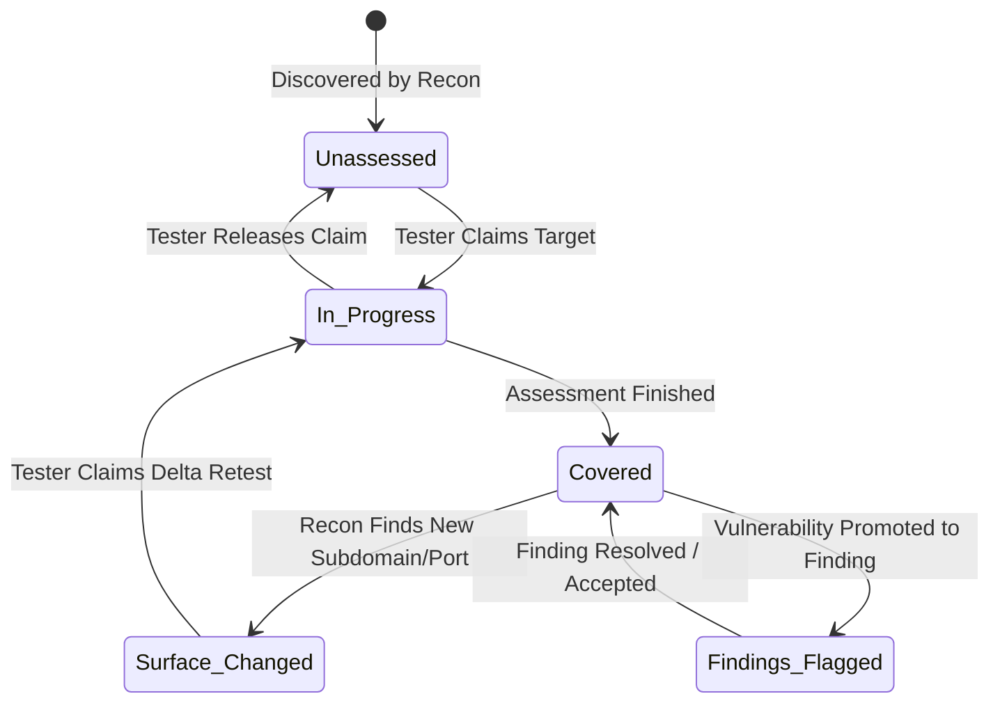

# Threat Hunting & Penetration Testing Coverage Tracking
## Implementation & Architecture Plan

---

### 1. Executive Summary & Objectives
This document outlines the end-to-end implementation plan for multi-user threat hunting and penetration testing tracking within the Recon Dashboard. As the estate expands and continuous recon uncovers subdomains, endpoints, and cloud assets, security testers need clear visibility into:
1. **What has been assessed** vs. **what is unassessed**.
2. **Who covered each target** (auditable multi-user attribution with timestamps and methodology notes).
3. **Who is actively testing a target** (claiming targets to eliminate duplicate work).
4. **Visual network topology integration** (color-coded status rings, filters, and 1-click test actions directly on the graph).
5. **Continuous recon delta alerts** (automatically flagging when attack surface changes on already-covered targets).

---

### 2. Threat Hunting Lifecycle & States

Every domain and asset follows a defined penetration testing workflow:



#### Coverage Status Definitions:
- **`unassessed`** (Default / Gray): Discovered by automated scanners, awaiting tester review.
- **`in_progress`** (Amber / Pulsing): Claimed by an active tester. Displays tester's name to prevent duplicate testing.
- **`covered`** (Emerald Green): Tested and signed off by a tester with methodology notes.
- **`findings_flagged`** (Purple): Discovered vulnerabilities linked directly to the Findings module.
- **`surface_changed`** (Rose Badge / Amber Ring): Previously covered, but continuous recon detected new subdomains, ports, or buckets since the sign-off date.

---

### 3. Database Schema Design (MongoDB)

#### A. Domain Document Schema Update (`domains` collection)
Extend existing domain documents with a dedicated `threat_hunt` sub-document:

```json
{
  "_id": "ObjectId(...)",
  "domain": "api.internal.example.com",
  "workspace_id": "ObjectId(...)",
  "threat_hunt": {
    "status": "covered",
    "claimed_by": "john",
    "claimed_at": "2026-10-29T08:15:00Z",
    "covered_by": "john",
    "covered_at": "2026-10-29T10:45:00Z",
    "last_assessed_at": "2026-10-29T10:45:00Z",
    "scope_type": "in_scope_full",
    "methodology": [
      "manual_web_app",
      "port_service_review",
      "cloud_storage_audit",
      "auth_bypass_check"
    ],
    "notes": "Reviewed public API endpoints. 403 bypass attempted on /admin; properly restricted.",
    "linked_findings_count": 0,
    "surface_changed": false,
    "last_recon_snapshot_count": {
      "subdomains": 14,
      "open_ports": 6,
      "cloud_buckets": 2
    },
    "history": [
      {
        "action": "claimed",
        "username": "john",
        "timestamp": "2026-10-29T08:15:00Z"
      },
      {
        "action": "marked_covered",
        "username": "john",
        "timestamp": "2026-10-29T10:45:00Z",
        "methodology": ["manual_web_app", "port_service_review"],
        "notes": "Assessment completed."
      }
    ]
  }
}
```

#### B. Activity Audit Log (`hunt_activities` collection)
To support team reporting, leaderboards, and compliance sign-offs:
- `timestamp`: UTC datetime.
- `domain`: Target FQDN.
- `workspace_id`: Active workspace.
- `username`: Operator username.
- `action`: `claim` | `release` | `mark_covered` | `add_note` | `flag_finding`.
- `details`: Metadata payload.

---

### 4. API Endpoints Specification

Add the following endpoints to `app/main.py`:

| Method | Endpoint | Description |
|---|---|---|
| `POST` | `/api/domains/{domain_id}/hunt/claim` | Current user claims a domain (`status: in_progress`). |
| `POST` | `/api/domains/{domain_id}/hunt/release` | Release claim back to `unassessed`. |
| `POST` | `/api/domains/{domain_id}/hunt/cover` | Mark domain as `covered`, log user, methodology tags, and notes. |
| `POST` | `/api/domains/{domain_id}/hunt/note` | Append a progress note or checklist update. |
| `GET`  | `/api/threat-hunting/stats` | Estate-wide coverage % and tester activity breakdown. |
| `GET`  | `/api/threat-hunting/my-targets` | Fetch domains claimed or assigned to the current user. |

---

### 5. Interactive Network Map UI (Vis.js Integration)

#### A. Node Color-Coding & Status Rings
In `templates/dashboard.html` (`buildNetworkGraph()`):
- **Unassessed**: Default subtle node styling (`#38bdf8` / slate borders).
- **In Progress / Claimed**: Amber highlight (`#f59e0b`) with tester initials badge (`[JD]`).
- **Covered**: Emerald green node border/fill (`#10b981`) with hover tooltip: *"Covered by @john on Oct 29"*.
- **Findings Identified**: Purple accent (`#a855f7`) with finding count badge.
- **Surface Changed**: Pulsing amber/rose halo alerting the tester to new assets.

#### B. Map Coverage Filter Bar
Above the network topology canvas, add a filter toggle:
- `All Assets`
- `Unassessed Only` (Targets ready for hunting)
- `My Active Targets` (Targets currently claimed by logged-in user)
- `Covered Assets`
- `Attack Surface Changed`

#### C. 1-Click Action Drawer & Context Menu
Clicking or right-clicking any node on the graph displays:
- Target name, IP, and discovered services.
- Current coverage badge and assigned tester.
- Buttons:
  - **[ Claim for Threat Hunt ]** (or **[ Release Claim ]** if already claimed by user).
  - **[ Mark as Covered ]** (opens modal for methodology checklist & notes).
  - **[ Log Finding ]** (links directly to create finding modal).

---

### 6. Continuous Recon Surface-Change Detection

In `tools/loop_orchestrator.py` or post-scan completion handlers:
- When continuous scanning finishes for a domain marked `covered`:
  - Compare current subdomains/ports count against `threat_hunt.last_recon_snapshot_count`.
  - If new assets were discovered, set `threat_hunt.surface_changed = true`.
  - Trigger a system notification: *"Attack surface changed on covered domain example.com (+2 subdomains discovered)"*.

---

### 7. Phased Implementation Roadmap

- [ ] **Phase 1: Backend Foundation & Data Model**
  - Add `threat_hunt` default sub-document initialization for domains.
  - Implement `/api/domains/{id}/hunt/*` endpoints with session-based user attribution.
  - Log all hunt actions to audit log.

- [ ] **Phase 2: Network Topology Visualization & 1-Click Controls**
  - Update `templates/dashboard.html` Vis.js node color palette for hunt statuses.
  - Add coverage filter bar to the network map header.
  - Implement Quick Action drawer to claim, note, and mark covered directly from the canvas.

- [ ] **Phase 3: Estate Coverage Metrics & Team Leaderboard**
  - Add coverage progress bar widget to dashboard header (`X / Y Domains Covered (Z%)`).
  - Add Threat Hunting overview table showing team members and target allocation.

- [ ] **Phase 4: Delta Detection & Retest Alerts**
  - Implement snapshot comparison upon scan completion.
  - Add visual `Surface Changed` indicator on network graph.
