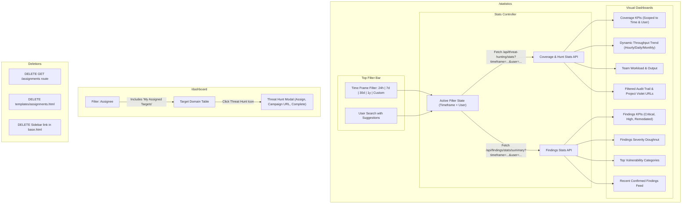

# Implementation Plan: Retire Assignments, User Search, Time Frame Filtering & Findings Statistics

## 1. Objectives & Executive Summary
1. **Retire Assignments**: Fully delete the `/assignments` route and `templates/assignments.html`, removing all navigation and legacy references.
2. **Time Frame Filtering in Statistics**: Add time window controls to filter statistics by:
   - **Last 24 Hours** (`24h`)
   - **Last Week** (`7d`)
   - **Last Month** (`30d`)
   - **Last Year** (`1y`)
   - **Custom Range** (`custom` with start and end datepickers)
   - **All Time** (`all`)
3. **User Filter in Coverage Statistics**: Add a searchable user input with live auto-suggestions to the **Coverage Statistics** tab, allowing team leads and testers to filter coverage statistics, KPIs, throughput velocity, and audit activity by individual user.
4. **Findings Statistics Integration**: Add comprehensive **Vulnerability & Security Findings Statistics** to the Statistics dashboard:
   - Severity Breakdown (Critical, High, Medium, Low, Info)
   - Status Distribution (Confirmed, In Progress, Remediated, Draft)
   - Top Vulnerability Categories / Classes
   - Recent Findings Feed with clickable target links
   - Multi-dimensional correlation: Filter findings simultaneously by **User** and **Time Frame**.
5. **Consolidate Threat Hunting into Dashboard**: Enhance the main dashboard's assignee filter with a 1-click **"My Assigned Targets"** option so testers retain instant access to their personal backlog.

---

## 2. Architecture & Data Flow

---

## 3. Detailed Component Plan

### A. Time Frame Filtering (`templates/statistics.html` & `app/main.py`)
1. **API Support (`app/main.py`)**:
   - Update `GET /api/threat-hunting/stats` and `GET /api/findings/stats/summary` to accept:
     - `timeframe: Optional[str] = Query("all")` (`24h`, `7d`, `30d`, `1y`, `custom`, `all`)
     - `start_date: Optional[str] = Query(None)` (ISO `YYYY-MM-DD`)
     - `end_date: Optional[str] = Query(None)` (ISO `YYYY-MM-DD`)
   - **Date Range Calculation**:
     - `24h`: `datetime.utcnow() - timedelta(hours=24)` (hourly grouping in throughput chart)
     - `7d`: `datetime.utcnow() - timedelta(days=7)` (daily grouping)
     - `30d`: `datetime.utcnow() - timedelta(days=30)` (daily grouping)
     - `1y`: `datetime.utcnow() - timedelta(days=365)` (monthly or weekly grouping)
     - `custom`: parsed from `start_date` to `end_date`
   - Filter criteria:
     - Coverage: `threat_hunt.covered_at` in range.
     - Hunt activity: `timestamp` in range.
     - Findings: `created_at` in range.

2. **UI Implementation (`templates/statistics.html`)**:
   - Header / Toolbar Control Bar:
     - Button group / segmented control:
       `[Last 24h] [Last 7d] [Last 30d] [Last 1y] [All Time] [Custom Range]`
     - When "Custom Range" is clicked:
       Reveals an inline date range picker (`Start Date` -> `End Date`) with an "Apply" button.
     - Active indicator: Highlights the active timeframe button.

---

### B. Findings Statistics Integration (`templates/statistics.html` & `app/main.py`)
1. **API Enhancement (`app/main.py`)**:
   - Return findings aggregated data scoped to the active `timeframe` and `user`:
     - Severity counts: `critical`, `high`, `medium`, `low`, `info`.
     - Status counts: `confirmed`, `in_progress`, `remediated`, `draft`.
     - Top vulnerability categories with counts.
     - Recent confirmed findings list with target domain, severity, title, author, and timestamp.

2. **UI Implementation (`templates/statistics.html`)**:
   - **Findings Metric Cards Row**:
     - Total Findings Logged (in time window)
     - Critical Issues (Red badge with pulse indicator)
     - High Issues (Orange badge)
     - Remediated Issues (Emerald badge with resolution rate %)
   - **Findings Visual Charts**:
     - **Findings Severity Distribution** (Doughnut Chart: Critical, High, Medium, Low, Info).
     - **Top Vulnerability Categories** (Horizontal Bar Chart).
   - **Recent Findings Feed**:
     - Interactive table listing latest confirmed security findings with clickable target links to view in `/dashboard`.

---

### C. Coverage Statistics: User Search & Auto-Suggestions (`templates/statistics.html`)
1. **User Search Bar with Suggestions**:
   - Sleek autocomplete input: `Search user statistics (e.g. admin)...`
   - Auto-suggestions popover displaying matching team members with avatars and roles.
   - Active filter badge (`@username ✕`) to easily clear user-scoping.
   - Clicking any tester in the Team Workload table automatically applies this filter.
2. **User-Scoped Metrics**:
   - When a user is selected, KPIs, throughput velocity, Project Violet campaigns, audit trail, and findings reflect that specific tester's contributions within the selected timeframe.

---

### D. Complete Removal of Assignments Route & Template
1. **Delete Route in `app/main.py`**:
   - Remove `@app.get("/assignments")` completely (clean 404).
2. **Delete Template**:
   - Delete `templates/assignments.html`.
3. **Remove Navigation Links in `templates/base.html`**:
   - Remove the `Assignments` link item from the sidebar navigation.
4. **Update Links in `templates/statistics.html`**:
   - Remove header button `<a href="/assignments">Assignments</a>`.
   - Re-point doughnut chart clicks to `/dashboard?coverage=${selectedStatus}`.
   - Update empty state link to point to `/dashboard`.

---

### E. Main Dashboard: "My Assigned Targets" (`templates/dashboard.html`)
1. **1-Click "My Assigned Targets"**:
   - In `#filter-assigned-user`, add:
     `<option value="__me__">📌 My Assigned Targets</option>`.
   - When selected, filters the dashboard table to targets where `assigned_users` includes `current_user.username` or `claimed_by == current_user.username`.
2. **URL Parameter Sync**:
   - Automatically initializes filters from query params (`?coverage=...` and `?assigned_user=...`).

---

## 4. Step-by-Step Implementation Sequence

| Phase | Target File | Action |
| :--- | :--- | :--- |
| **Phase 1** | `app/main.py` | 1. Update `GET /api/threat-hunting/stats` with `timeframe`, `start_date`, `end_date`, and `user` query parameters. 2. Integrate findings aggregation into stats API with timeframe and user filtering. 3. Delete `@app.get("/assignments")` route completely. |
| **Phase 2** | `templates/statistics.html` | 1. Add Time Frame segmented control bar (`24h`, `7d`, `30d`, `1y`, `All`, `Custom`) with custom datepickers. 2. Add User Search bar with live auto-suggestions. 3. Add Findings KPI cards, Severity Doughnut chart, Category Bar chart, and Recent Findings feed. 4. Re-point tester table rows to set the user filter. 5. Remove header "Assignments" button and re-point chart clicks to `/dashboard`. |
| **Phase 3** | `templates/base.html` | Remove Assignments link from sidebar navigation. |
| **Phase 4** | `templates/dashboard.html` | Add "📌 My Assigned Targets" (`__me__`) to assignee filter dropdown. |
| **Phase 5** | `templates/assignments.html` | Delete `templates/assignments.html`. |
| **Phase 6** | Verification | 1. Test timeframe filtering (`24h`, `7d`, `30d`, `1y`, `custom`). 2. Test User Search & suggestions on Coverage tab. 3. Test Findings severity chart, category chart, and recent findings feed. 4. Verify `/assignments` route is deleted. 5. Test "My Assigned Targets" filter on Dashboard. |

---

## 5. Verification Checklist
- [x] Timeframe buttons (`24h`, `7d`, `30d`, `1y`, `All`, `Custom`) filter coverage and findings statistics dynamically.
- [x] Selecting "Custom" reveals date pickers; submitting updates all stats for that date window.
- [x] User search input shows live matching suggestions as you type.
- [x] Selecting a user updates the Coverage KPI cards, throughput chart, campaigns, audit trail, and findings for that specific user within the selected timeframe.
- [x] Findings section displays Total Findings, Critical, High, and Remediated metrics.
- [x] Findings Severity Doughnut chart and Top Categories bar chart render cleanly.
- [x] Recent findings feed displays confirmed security issues with clickable links.
- [x] Clicking the `✕` pill resets back to global estate coverage and findings statistics.
- [x] Direct visit to `/assignments` returns 404 (route cleanly removed).
- [x] Sidebar has no Assignments link.
- [x] Main dashboard features "My Assigned Targets" option in the Assignee dropdown.
- [x] Threat Hunt modal on the dashboard continues to assign, sign off, and record Campaign URLs seamlessly.
